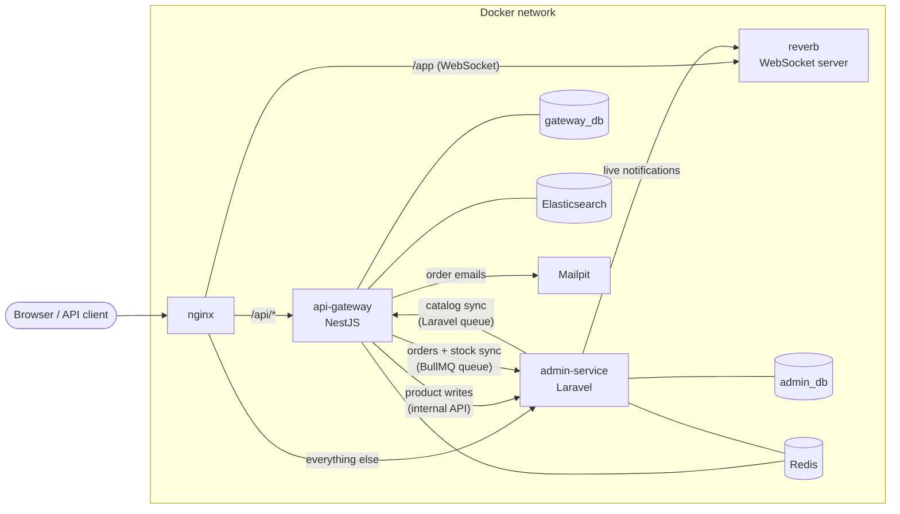

# Hybrid E-commerce Platform

[](https://github.com/HristiyanBorisov/hybrid-e-commerce/actions/workflows/ci.yml)

A Laravel admin panel and a NestJS API gateway, each with its own PostgreSQL database.

| Folder               | What it is                                                     |
|----------------------|----------------------------------------------------------------|
| `api-gateway/`       | NestJS — public REST API (users, products, inventory, orders)  |
| `admin-service/`     | Laravel — admin panel (catalog, order management, reports)     |
| `docker/`            | nginx and PostgreSQL configuration                             |
| `docs/`              | Database design and the exact SQL schema                       |
| `keys/`              | RSA key pair for login tokens, created by `make keys` (never committed). Only `keys/public/` is mounted into Laravel |
| `.github/workflows/` | CI/CD pipeline (GitHub Actions)                                |
| `docker-compose.yml` | All services                                                   |
| `Makefile`           | Every command you need — run `make` to list them               |

## Quick start

Requirements: Docker (with Compose) and `make`. Nothing else needs to be installed locally. The whole stack uses
about 2–3 GB of memory (Elasticsearch alone about 1 GB).

```bash
make setup
```

| URL                              | What                                  |
|----------------------------------|---------------------------------------|
| http://localhost:8080/admin      | Admin panel (Laravel) — log in as `admin@example.com` |
| http://localhost:8080/api/health | API gateway (NestJS)                  |
| http://localhost:8080/api/docs   | API documentation (Swagger)           |
| http://localhost:8025            | Mailpit — catches all outgoing email  |

### Demo data

`make setup` seeds these users, the demo catalog, 50 units of stock per product and 84 demo orders over the last
90 days, so the dashboard and the reports have data (demo data only). Run `make seed` again at any time — what already
exists is skipped.

| Email               | Password   | Role     |
|---------------------|------------|----------|
| `admin@example.com` | `password` | admin    |
| `alice@example.com` | `password` | customer |
| `bob@example.com`   | `password` | customer |

## How it fits together



- **nginx** is the only way in: `/api/*` goes to NestJS, everything else to Laravel. One domain, so one login cookie
  works for both.
- **api-gateway (NestJS)** owns users, orders and stock. It's the central user service: it checks passwords and
  signs the login tokens.
- **admin-service (Laravel)** owns the catalog (categories, products) and is the admin panel.
- **reverb** (Laravel Reverb) pushes live notifications to open admin pages.
- **elasticsearch** answers product searches for the API gateway (one more copy of the catalog, built from it).
- Each service keeps a **read-only copy** of what it needs from the other, sent through queues.

## Design decisions

The database design and its reasons are explained in detail in [docs/database.md](docs/database.md). In short:

1. **A database per service.** Each service owns its tables; PostgreSQL roles stop either service from reaching the
   other's database. The brief allowed a shared database too — separate ones let each service change, deploy and fail
   on its own.
2. **Copies kept in sync by queued messages** (the brief's "webhook/queue" option). Every message is the **whole
   record plus a version**, and a copy saves it only if the version is newer — in one atomic statement. Repeated,
   retried or out-of-order messages change nothing, so the queues can simply retry. `make resync` sends everything
   again.
3. **Writes go to the owner.** The gateway's `POST/PUT /api/v1/products` are forwarded to Laravel; the admin panel's
   order-status changes and stock adjustments go to the gateway. The owner's answer is saved into the copy at once, so
   whoever made the change sees it straight away.
4. **Service-to-service calls use a shared API key** (compared in constant time) on internal routes that nginx never
   exposes publicly.
5. **One login for both services.** RS256 JWTs: the gateway signs with the private key, Laravel only has the public
   key. The token travels as an `HttpOnly`, `SameSite=Lax` cookie on the shared domain (or as a Bearer token for API
   clients), and the user is re-checked on every request.
6. **UUIDv7 ids** everywhere — the same id in the owner and the copy, ordered by time. **Money as integer cents**.
   **Every fixed set of values is an enum** in PostgreSQL and in code.
7. **Stock can't be oversold.** One conditional `UPDATE` takes stock (PostgreSQL locks the row), backed by
   `CHECK (quantity >= 0)`; status changes lock the order's row. Every stock change is recorded with its reason.
8. **Slow or unreliable work runs in queues** with retries: emails, image thumbnails, CSV imports and the syncs. A
   request never waits for the other service to be up, except when it writes to that service's data. The helpers
   (Redis cache, Elasticsearch search) fail open: if one is down, the API answers from the database instead.
9. **The same structure everywhere.** Laravel: route → controller → Form Request (`toDto()`) → Action → Eloquent →
   Resource or Blade view. NestJS: modules with controller → service → TypeORM, one DTO class per file, global guards,
   one error format, Swagger generated from the code.
10. **Everything runs in Docker through the Makefile**, the tests use their own `_test` databases, and CI fails below
    90% coverage. Coverage leaves out declarations only: NestJS modules and DTOs (the e2e tests run them, but their
    decorators make the compiler emit branches no test can take), migrations, entry scripts; Laravel's providers.

Left out on purpose: a production Docker setup and a live deployment (this is a project for technical review), real
payments and refunds, several currencies, shipping addresses.

## Admin panel: catalog

- **Categories** nest to any depth (a category can't move below itself). Only empty categories can be deleted.
- **Products**: prices are typed as decimals and stored as cents. Uploaded images get a 400×400 WebP thumbnail from a
  queued job. Deleting moves a product to the **trash**, where it can be restored — it's never deleted permanently.
- **CSV import/export** with the columns `sku,name,category_slug,price,description` — an export can be imported again.
  Imports run in the queue: a row with an existing SKU updates that product, any other row creates one, and invalid
  rows are listed with their line number on the Imports page.
- **Sync**: every category/product change is sent to the API gateway (which keeps a copy) by a queued job, with the
  shared `INTERNAL_API_KEY`.
- **Internal API** for the gateway: `POST/PUT /internal/v1/products` (JSON, Laravel Resources). It's only served on
  nginx port 8081, which isn't published — from outside, `/internal/*` is a 404.

## Admin panel: orders, stock and reports

The admin service keeps a **copy** of the gateway's orders and stock levels, sent by the gateway's `admin-sync` queue
to `PUT /internal/v1/sync/{orders|stock-levels}/:id` (API key, nginx port 8081 only). Every screen reads that copy — no
page waits for the other service — and every change goes to the owner:

- **Dashboard**: sales today and this month, orders waiting to ship, products with 5 or fewer in stock, the latest
  orders.
- **Orders**: filter by status, customer (name or email) and date. An order's page offers only the moves its status
  allows (`Mark as shipped`, `Cancel order` …). The change is made by the gateway with the admin's own token.
- **Stock**: shown in the product list; adjusted on the product's page, through the gateway in the same way.
- **Sales reports** (`Reports`): per day, week (from Monday) or month — orders, units sold, revenue and average order,
  with empty periods shown as zeros. Only paid, shipped and delivered orders count, by the day they were placed (UTC).
  Export to **CSV** or **PDF** (`barryvdh/laravel-dompdf`).

## API

Interactive documentation: http://localhost:8080/api/docs (OpenAPI JSON at `/api/docs-json`), generated from the code.

Routes are versioned in the URL: `/api/v1/...`. Errors always have the same shape:
`{ "statusCode": 422, "message": "Validation failed", "errors": { "email": ["email must be an email"] } }`
(`errors` only on validation failures). Fields a request doesn't define are ignored. Every response carries an
`X-Request-Id` (yours, if you send one), which is forwarded to the other service and written to the logs.

### Login and users

| Endpoint                       | Who        | What |
|--------------------------------|------------|------|
| `POST /api/v1/auth/register`   | anyone     | `{ name, email, password }` → a new customer |
| `POST /api/v1/auth/login`      | anyone     | `{ email, password }` → `{ accessToken }`, also set as the login cookie |
| `POST /api/v1/auth/logout`     | anyone     | Clears the login cookie |
| `GET /api/v1/auth/me`          | logged in  | The current user |
| `GET /api/v1/users`            | admins     | Newest first; `?search=` (name or email), `?role=`, paging |
| `GET /api/v1/users/:id`        | admins     | One user |
| `POST /api/v1/users`           | admins     | `{ name, email, password, role }` |
| `PATCH /api/v1/users/:id`      | admins     | Any of those fields. Admins can't change their own role |
| `DELETE /api/v1/users/:id`     | admins     | Soft delete. Admins can't delete themselves |

Tokens are RS256, valid for 1 hour. Send them as `Authorization: Bearer <token>`, or let the browser send the cookie.
Every route requires a login unless it's public (health, register, login, logout, reading products). The admin
panel's login form uses the same gateway login and accepts only admins — logging into the admin panel also logs the
browser into the API, and logging out of either logs out of both.

### Products

| Endpoint                     | Who      | What |
|------------------------------|----------|------|
| `GET /api/v1/products`       | anyone   | Newest first. Filters: `search` (name or SKU), `category` (a slug — subcategories included), `minPriceCents`, `maxPriceCents`; paging with `page` and `limit` |
| `GET /api/v1/products/:id`   | anyone   | One product with its category and `stock`; deleted products answer 404 |
| `POST /api/v1/products`      | admins   | `{ categoryId, sku, name, description?, priceCents }` |
| `PUT /api/v1/products/:id`   | admins   | The same fields — replaces the product's details |

Prices are integer cents everywhere (`1999` = 19.99). Images are uploaded in the admin panel.

- **Reads** come from the gateway's own copy of the catalog and are **cached in Redis** (database 2, keys
  `catalog::*`). Every catalog or stock change clears the cache, and entries expire after 5 minutes anyway. If Redis
  is down, products are read from the database instead.
- **Search** (`search=`) is answered by **Elasticsearch**: typos are forgiven (`pixl` → *Pixel Pro 9*), a word can be
  cut short (`lapt` → the laptops), results are ranked by relevance across name, category and description, and a SKU
  matches exactly or by its beginning (`PHN-00`). The other filters and paging still apply. The index is kept up to
  date by the catalog sync, created and filled on startup when it's missing, and rebuilt by `make reindex`. If
  Elasticsearch is down, the search runs in the database (name or SKU contains the text) instead; after a failure
  Elasticsearch isn't asked again for 30 seconds, and such stand-in results are cached for only 10 seconds.
- **Writes** are forwarded to the admin service, which owns the catalog. Its validation errors come back unchanged as
  a 422 (e.g. a taken SKU), and if it's unreachable the answer is a 503.

### Orders and inventory

| Endpoint                                        | Who        | What |
|-------------------------------------------------|------------|------|
| `POST /api/v1/orders`                           | logged in  | `{ items: [{ productId, quantity }], paymentToken }` → a paid order (201) |
| `GET /api/v1/orders`                            | logged in  | Your orders, newest first; `?status=` and paging |
| `GET /api/v1/orders/:id`                        | logged in  | One of your orders (admins: any order) |
| `PATCH /api/v1/orders/:id/status`               | admins     | `{ status }` — `pending → paid → shipped → delivered`; `cancelled` from pending or paid |
| `POST /api/v1/inventory/:productId/adjustments` | admins     | `{ quantityChange }` — add (+) or remove (−) stock by hand |

**Placing an order** (`CheckoutService`):
1. Every product must exist and not be deleted — otherwise 422, per item. Names and prices come from the catalog,
   never from the request, and are stored with the order.
2. In one transaction the order is saved and its items are taken out of stock. If a product hasn't enough, the answer
   is **409** (`Not enough stock for "Desk Lamp": 2 left`) and nothing is saved.
3. The **payment** is charged through a `PaymentGateway`. The app uses a mock: the token `tok_declined` is declined,
   any other token is approved. A declined payment cancels the order and puts the stock back (**402**).
4. The order becomes `paid` and a **confirmation email** is queued and sent (Mailpit catches it locally).

**Queues** (BullMQ in Redis database 3): `order-emails` sends the confirmations; `admin-sync` sends orders and stock
levels to the admin service. A job carries only an id and sends the record as it is when it runs. Failed jobs are
retried 5 times (10 s, 20 s, 40 s, 80 s), and each failure is logged.

## GraphQL

`/api/graphql`, next to the REST API — open it in a browser for **Apollo Sandbox** (schema explorer and query
editor). It's built from the same DTO classes and calls the same services, so the data, validation, cache, login and
roles are the same as REST.

| Operation | Who | What |
|-----------|-----|------|
| `products(search, category, minPriceCents, maxPriceCents, page, limit)` | anyone | Like `GET /api/v1/products` |
| `product(id)` | anyone | One product |
| `me` | logged in | The current user |
| `myOrders(status, page, limit)` / `order(id)` | logged in | Your orders (admins: any order by id) |
| `placeOrder(input: { items, paymentToken })` | logged in | The same checkout as `POST /api/v1/orders` |
| `changeOrderStatus(id, status)` | admins | Like `PATCH /api/v1/orders/:id/status` |

```graphql
query {
  products(category: "phones", limit: 5) {
    meta { total totalPages }
    data { name priceCents stock category { name } }
  }
}
```

Log in through REST (`POST /api/v1/auth/login`) and send the token as `Authorization: Bearer …` (or the cookie).
Errors have the REST details in `extensions`, e.g. `{ "code": "UNPROCESSABLE_ENTITY", "statusCode": 422,
"errors": { "limit": ["limit must not be greater than 100"] } }`. Enum values use their GraphQL names: `Shipped`,
`Customer` (REST: `shipped`, `customer`). Logging in and the admin endpoints stay REST-only.

## Real-time updates

Each side uses its framework's standard tool:

**Customers — live order updates (NestJS, socket.io).** Connect to `/api/socket.io` with the login token; from then
on every change of one of your orders arrives as `order.updated` — e.g. the moment an admin ships it.

```js
import { io } from 'socket.io-client';

// In a browser on this domain the login cookie is enough; other clients send the token
const socket = io('http://localhost:8080', { path: '/api/socket.io', auth: { token: accessToken } });

socket.on('order.updated', (order) => console.log(order.id, order.status)); // { id, status, totalCents, version, updatedAt }
socket.on('connect_error', (error) => console.log(error.message));          // "Invalid or missing login token"
```

The token is checked like on every HTTP request (a deleted user can't connect), and each customer only receives
their own orders.

**Admins — live notifications (Laravel Echo + Laravel Reverb).** Every open admin page shows a notification when an
order arrives or changes — *New order from Alice Customer · 1,598.00 · View order*. Laravel sends the event (queued,
after the change is committed) to **Reverb**, Laravel's WebSocket server, which browsers reach through nginx at `/app`.
The private `admin` channel only lets admins in (`/broadcasting/auth`).

## Development

Every command runs inside Docker. Run `make` to list them all; the ones you'll use most:

| Command                     | What it does |
|-----------------------------|--------------|
| `make up` / `make down`     | Start (and wait until healthy) / stop all services |
| `make logs service=api-gateway` | Follow one service's logs (or all, without `service=`) |
| `make test`                 | NestJS unit + e2e tests, Laravel tests |
| `make coverage`             | The same with coverage — fails below 90% |
| `make lint` / `make format` | Check / fix the code style (oxlint + Prettier, Pint) |
| `make fresh` + `make seed`  | Drop both databases, migrate again, fill with demo data |
| `make resync`               | Send everything each service copies from the other again |
| `make reindex`              | Rebuild the product search index (Elasticsearch) from the gateway's catalog |
| `make assets`               | Rebuild the admin panel's CSS/JS (after adding Tailwind classes to a view) |

The dev servers reload code changes by themselves. After changing an `.env` file or installing a package, restart the
service that uses it (`make restart`, or e.g. `docker compose restart api-gateway admin-worker`).

The tests never touch your data. Laravel's run on `admin_db_test` with in-memory cache, sessions and queues; NestJS's
on `gateway_db_test` and their own Redis databases, and they refuse to run against a database whose name doesn't end
with `_test`. No test calls the other service or sends real email.

## CI/CD

[`.github/workflows/ci.yml`](.github/workflows/ci.yml) runs on every push and pull request:

1. **`make setup`** on the fresh checkout — exactly the Quick start above, so a broken setup fails the build.
2. A **smoke test** through nginx: the API's health check, Laravel, the admin login page, the seeded products.
3. **`make lint`** and **`make coverage`** (both services' tests; fails below 90% coverage).

The NestJS coverage report is kept with each run (*Artifacts*), and a failing run prints the containers' logs.

**Deployment** runs after a green build of `main`, once a server is configured — until then the job is skipped. It
connects over SSH and updates the server in place: `git pull`, then `make build install assets up migrate`. It
deploys this same Docker setup (there's no separate production configuration). To switch it on:

1. On the server: install Docker, `make` and `git`, clone the repository, run `make setup`, and add a deploy key's
   public half to `~/.ssh/authorized_keys`.
2. In GitHub → *Settings* → *Secrets and variables* → *Actions*:
   - **Variables**: `DEPLOY_HOST` (the server), `DEPLOY_USER` (the SSH user), `DEPLOY_PATH` (the clone's folder);
   - **Secrets**: `DEPLOY_SSH_KEY` (the deploy key's private half) and `DEPLOY_KNOWN_HOSTS` (the output of
     `ssh-keyscan <server>`, so the runner only talks to that server).

## More documentation

- [Database design](docs/database.md) — tables, who owns which data, how the services sync, design choices
- [SQL schema](docs/schema.sql) — the exact schema of both databases
- [API documentation](http://localhost:8080/api/docs) — interactive Swagger docs, generated from the code
