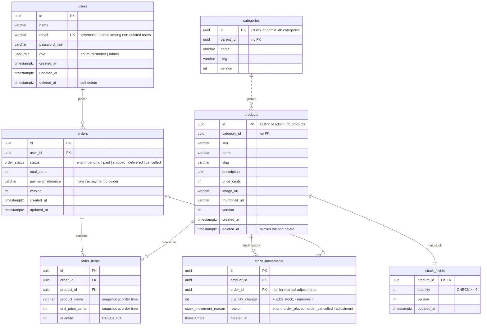
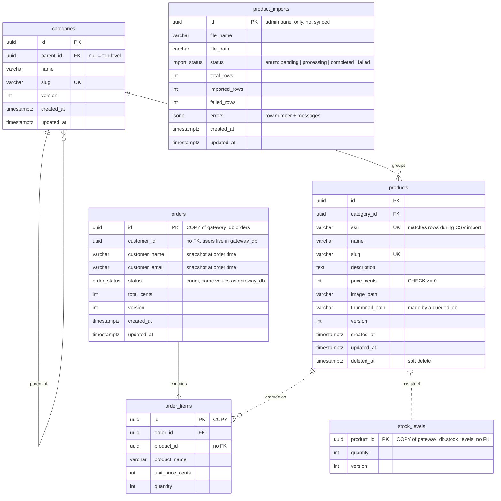

# Database design

Two services, two databases on one PostgreSQL server:

| Database     | Service                 | Owns (only writer)                                   | Keeps read-only copies of            |
|--------------|-------------------------|------------------------------------------------------|--------------------------------------|
| `gateway_db` | api-gateway (NestJS)    | `users`, `stock_levels`, `stock_movements`, `orders`, `order_items` | `categories`, `products`             |
| `admin_db`   | admin-service (Laravel) | `categories`, `products`, `product_imports`          | `orders`, `order_items`, `stock_levels` |

A table has exactly **one owner**. The other service keeps a **copy** that only the sync process writes
to — never the application code.

In the diagrams, solid lines are foreign keys and dashed lines are references **without** a foreign key (see choice 3).
The exact SQL is in [schema.sql](schema.sql). The migrations of both services create exactly that schema
(checked by comparing `pg_dump` output of the migrated databases with a database built from `schema.sql`).

## gateway_db (NestJS)

## admin_db (Laravel)

Laravel also keeps its framework table `failed_jobs`. Cache, sessions and queues live in Redis.
`product_imports` (added with the CSV import) records each import's progress and the rows that failed; it's only used
by the admin panel and isn't synced.

## How the copies stay in sync

| Data         | From → to            | Sent when                      | What is sent                                   |
|--------------|----------------------|--------------------------------|------------------------------------------------|
| Categories   | admin → gateway      | created, updated, deleted      | the whole category                             |
| Products     | admin → gateway      | created, updated, soft-deleted, restored | the whole product, including `deleted_at` |
| Orders       | gateway → admin      | placed, status changed         | the whole order with its items and the customer's name and email |
| Stock levels | gateway → admin      | any stock change               | product id and quantity                        |

Every message carries the **whole current state** plus a `version` number, not a description of what changed.
When the admin service changes something the gateway owns (an order's status, a stock adjustment), it saves the
gateway's answer — which carries the new version — into its copy right away, and the sync message that follows is
ignored as already known.
The receiver saves it only if the version is newer than what it already has — in one atomic query
(`INSERT … ON CONFLICT (id) DO UPDATE … WHERE copy.version < new.version`). Receiving the same message twice,
or an old message after a newer one (e.g. after a retry), changes nothing.

## Design choices

1. **Database per service.** Each service can change its schema, deploy and fail on its own. Each service's
   database role has no access to the other database, so the rule is enforced by PostgreSQL, not just by convention.

2. **One owner per table, copies are read-only.** Two services writing the same data would conflict.
   When the admin changes data owned by NestJS (an order status, a stock adjustment), Laravel asks NestJS to do it.

3. **Copies have no foreign keys.** Messages can arrive out of order — a product could arrive before its category.
   A foreign key would reject it and the sync would get stuck. The owner already guarantees the data is valid, and
   for the same reason copies have no CHECK constraints: the owner's rules apply. Enum types are still used on copies
   (choice 6): the code on both sides has to know every status anyway. Two foreign keys are still safe:
   - a copied order and its items arrive together in one message;
   - a service's **own** tables may point to a copy in the same database (e.g. `order_items.product_id` → `products`),
     because the service only creates those rows after the copy exists, and products are never deleted (choice 8).

4. **UUIDv7 ids, generated by the application.** The same id is used in the owner's table and in the copy,
   so there's no id mapping. v7 ids start with a timestamp, so new rows are added at the end of the index
   (fast inserts, like auto-increment). The application generates them so an id is known before the row is saved.

5. **Money as integer cents** (`price_cents`, `total_cents`). Decimal maths in JavaScript and PHP floats gives
   rounding errors (`0.1 + 0.2`). Whole numbers are exact. The `_cents` suffix makes the unit obvious.
   One currency is assumed.

6. **Every fixed set of values is an enum, in the database and in the code.**

   | PostgreSQL enum type    | Values                                                  | Used in                                       |
   |-------------------------|---------------------------------------------------------|-----------------------------------------------|
   | `user_role`             | `customer`, `admin`                                     | gateway_db `users`                            |
   | `order_status`          | `pending`, `paid`, `shipped`, `delivered`, `cancelled`  | gateway_db `orders`, admin_db `orders` (copy) |
   | `stock_movement_reason` | `order_placed`, `order_cancelled`, `adjustment`         | gateway_db `stock_movements`                  |
   | `import_status`         | `pending`, `processing`, `completed`, `failed`          | admin_db `product_imports`                    |

   In code the same values are TypeScript enums (NestJS) and PHP backed enums (Laravel). The database rejects any
   value outside the list, and the code can't use a value that doesn't exist.
   - Adding a value later is a one-line migration (`ALTER TYPE … ADD VALUE`). Removing one means recreating the
     type, so values are only ever added.
   - Laravel's `$table->enum()` would create a `varchar` + `CHECK` on PostgreSQL, not a real enum type, so the
     Laravel migrations create the type explicitly.

7. **`timestamptz` everywhere, stored in UTC.** Two services compare and display the same timestamps, so they must
   be unambiguous.

8. **Deleting:**
   - **Products** are soft-deleted and can be restored (required). There is no permanent delete, so a product that
     was ordered never disappears from order history.
   - **Users** are soft-deleted, because their orders must stay intact. The email is unique only among
     non-deleted users (a partial unique index), so a deleted user's email can be registered again.
     A CHECK keeps emails lowercase, so `Eve@Example.com` and `eve@example.com` can't both exist.
   - **Categories** are deleted permanently, but only when they have no subcategories and no products (including
     soft-deleted ones). The foreign keys use `RESTRICT`, so the database enforces this too.

9. **Order items store the product name and price at the time of the order.** Changing a product's price later must
   not change past orders, totals or reports. For the same reason the copied order stores the customer's name and
   email as they were when ordering.

10. **Stock has its own table, plus a history of every change.**
    - `stock_levels` is separate from `products` because NestJS owns stock but not products.
    - Stock is taken with one conditional `UPDATE … WHERE quantity >= n` (the row is locked while it runs), so two
      orders can't both take the last item. `CHECK (quantity >= 0)` is the last line of defence: even if the code had
      a bug, the database would reject negative stock.
    - A product gets its `stock_levels` row when it's first stocked; until then its stock counts as 0.
    - `stock_movements` records why stock changed (order, cancellation, manual adjustment), so every number
      can be explained. A CHECK makes sure order-related movements point to their order and manual adjustments don't.

11. **Nested categories use a `parent_id` column** (adjacency list), the simplest model for a tree.
    Subcategories at any depth are read with a recursive query. Preventing loops (a category becoming its
    own ancestor) is checked in the application.

12. **Indexes:** every foreign key column (PostgreSQL doesn't index them automatically), the unique columns,
    and the columns used for filtering: `products.category_id`, `orders(user_id, created_at)`,
    `orders(status, created_at)` for the order list and sales reports.

### Left out on purpose (keep it simple)

- **Shipping addresses, multiple currencies, multiple images per product:** not required by the task.
- **Stock reservations:** payment is a synchronous mock, so stock is decremented right away and returned if the order
  is cancelled.
- **Refunds:** cancelling a paid order puts its stock back, but no money moves — payments are a mock.
- **Guaranteed message delivery (outbox pattern):** messages are sent by queued jobs with retries. `make resync`
  re-sends the whole catalog if the copies ever drift.
- **Full-text search indexes:** product search uses `ILIKE`, which is fine for this size. Elasticsearch is a bonus task.
